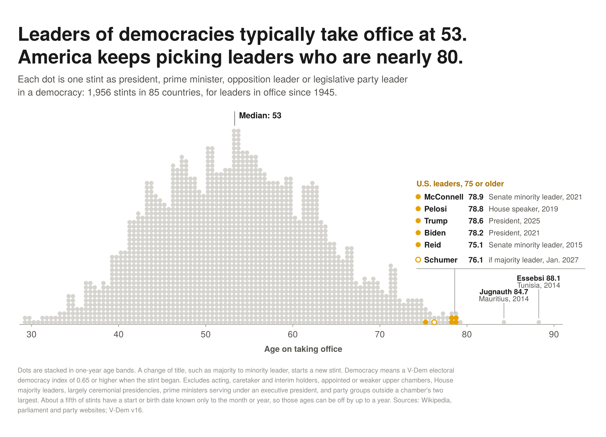

# Ages of democratic leaders, 1945–2026

This dataset records the age at which national leaders took office in democracies since 1945. It covers heads of government, executive presidents, formal opposition leaders, US congressional leaders, and the chairs of the two largest parliamentary groups in 25 countries. The goal is to place the ages of US leaders in comparison with leaders in other democracies.

Each row is one continuous spell in one office. The file holds 3,813 spells in 101 countries. 1,956 spells in 85 countries meet the rules used for the charts (`include_in_plot`).

Data are current to 13 November 2026.

## Files

| Path | Contents |
|---|---|
| `data/leaders_1945_2026.csv` | The dataset, one row per spell |
| `code/leader_age_distribution.R` | Draws the figure from the dataset |
| `figures/leader_age_distribution.png`, `.svg` | The figure |
| `CHANGELOG.md` | Corrections made after review |



## Unit of observation

A spell starts when a person takes an office and ends when they leave it. Re-election does not start a new spell. A move to a different office does, such as from US Senate minority leader to majority leader. A spell that began before 1945 keeps its real start date if the person was in office on 1 January 1945.

Age is (date minus birth date) divided by 365.2425. When only the birth year is known, 1 January is used and `birth_precision` is `year`.

## Offices

- **HoG.** Prime ministers, chancellors, the taoiseach, premiers and chairs of councils of ministers.
- **President.** Presidents in presidential and semi-presidential systems. Presidencies that are ceremonial throughout (Germany, Italy, Israel, India, Ireland and similar) are not collected. Presidencies that were ceremonial for part of the period are kept and flagged.
- **LoO.** Formal Leader of the Opposition offices, mostly in Westminster systems.
- **Lower_Floor.** The US House speaker, majority leader and minority leader; the Philippine House speaker and floor leaders; and chairs of parliamentary groups in lower or unicameral houses.
- **Upper_Floor.** US Senate party leaders; Australian Senate government and opposition leaders; Philippine Senate floor leaders; appointed upper houses (UK Lords, Canadian Senate), which are flagged; and chairs of parliamentary groups in upper houses.

Parliamentary group chairs give non-Westminster democracies an equivalent of US congressional party leaders. They are collected for the two largest groups in each directly elected chamber in Argentina, Austria, Belgium, Croatia, Czechia, Denmark, Estonia, Finland, France, Germany, Hungary, Italy, Japan, Lithuania, Luxembourg, the Netherlands, Norway, Poland, Portugal, Slovenia, South Korea, Spain, Sweden, Switzerland and Taiwan. Coverage is close to complete since 1990 or earlier for Germany, Austria, Switzerland, the Netherlands, Sweden, Norway, Finland, Poland, Czechia and Hungary. It is partial elsewhere. Westminster countries need no group chairs, because the prime minister and the formal opposition leader lead the parliamentary parties.

Upper houses are included only where the chamber is directly elected and neither house can override the other on ordinary legislation. In the plot these are the US Senate, Australia's Senate, Italy's Senate, and the Senate rows for Argentina, Brazil, Chile and Mexico. Japan's House of Councillors is kept but flagged `asymmetric_upper_chamber` and left out of the plot, because the lower house can override it by a two-thirds vote and alone decides the budget, treaties and the choice of prime minister. Including it would add 45 spells, 9 of them at 75 or older.

Lower-house bloc leaders for Argentina, Brazil, Chile and Mexico come from a partial supplement. They are flagged `partial_coverage` and left out of the plot.

## Plot rule

`include_in_plot` is TRUE when a spell meets all of these conditions.

- It has a birth date and a start date.
- The holder is not acting, caretaker or interim.
- The office is not in an appointed chamber or an asymmetric upper chamber.
- The office is not a US or Philippine House majority leader, a ceremonial presidency, or a prime minister serving under an executive president (Guyana after 1980, Sri Lanka after 1978).
- The row is not part of the partial Latin American supplement.
- For group chairs, the party was one of the two largest groups at the start of the spell (or this could not be established), and the chair was not head of government or formal opposition leader at the same time.
- The country's V-Dem electoral democracy index (`v2x_polyarchy`) in the start year is 0.65 or higher. For spells starting in 2026, the 2025 value is used.

`exclude_reason` lists every rule a spell fails.

## Columns

True/false columns are written as TRUE and FALSE, which R and pandas both read as logical values.

| Column | Description |
|---|---|
| `spell_id` | Row identifier for this release |
| `country` | Country name (Czechoslovakia rows are listed under Czechia) |
| `office_type` | HoG, President, LoO, Lower_Floor or Upper_Floor |
| `office` | Office title as given in the source |
| `chamber` | Chamber name, for parliamentary group chairs |
| `holder` | Name of the person |
| `party` | Party at the start of the spell |
| `birth_date` | YYYY-MM-DD |
| `birth_precision` | day, month or year |
| `start_date`, `end_date` | YYYY-MM-DD |
| `date_precision` | Precision of the start and end dates: day, month or year |
| `end_date_status` | `recorded`; `current holder (presumed)` when the end is blank and the row is the latest spell in that office and chamber; `not found` when the person left but no end date was found |
| `age_at_start`, `age_at_end` | Age in years, two decimals |
| `first_time_in_office` | TRUE for the person's first spell in that office |
| `title_switch` | TRUE for US leaders moving between majority and minority posts |
| `vdem_country` | Country name used to match V-Dem |
| `vdem_regime_at_start` | V-Dem Regimes of the World code in the start year (0 closed autocracy, 1 electoral autocracy, 2 electoral democracy, 3 liberal democracy) |
| `vdem_regime_label` | Label for the code above |
| `vdem_polyarchy_at_start` | V-Dem electoral democracy index in the start year |
| `vdem_libdem_at_start` | V-Dem liberal democracy index in the start year |
| `democracy_rule` | TRUE when `vdem_polyarchy_at_start` is 0.65 or higher |
| `acting` | Acting holder |
| `caretaker_or_interim` | Caretaker or interim holder, including Peru's congress-chosen successors |
| `collective_or_junta` | Head of a collective body or junta (informational) |
| `nonparty_technocrat` | Non-party technocrat (informational) |
| `appointed_chamber` | Office in an appointed upper house |
| `excluded_office` | US or Philippine House majority leader |
| `ceremonial_presidency` | Presidency that was largely ceremonial at the time |
| `subordinate_hog` | Prime minister under an executive president |
| `partial_coverage` | Row from the partial Latin American lower-house supplement |
| `asymmetric_upper_chamber` | Office in an upper house the lower house can override |
| `top2_at_start` | For group chairs, whether the party was one of the two largest groups at the start: Y, N or ? (not established) |
| `not_top2_group` | TRUE when `top2_at_start` is N |
| `top2_unclear` | TRUE when `top2_at_start` is ?; these rows stay in the plot |
| `held_hog_or_loo_concurrently` | Group chair who was head of government or formal opposition leader at the same time, so the spell is already counted in that office |
| `missing_birth_date`, `missing_start_date` | No birth date or no start date recorded |
| `include_in_plot` | Meets every rule in the plot rule above |
| `exclude_reason` | Every rule the spell fails, separated by semicolons |
| `unverified` | Fields not checked against a cited source (see below) |
| `dataset_part` | `executives_and_floor_leaders`, `legislative_group_chairs` or `latam_congress_supplement` |
| `source_url` | Sources, separated by semicolons. A label in parentheses says what a source was used for |
| `notes` | Source conflicts, date conventions and other remarks |

## How the data were collected

Rows were compiled with using llms to read Wikipedia lists of office holders, parliamentary and government websites and news reports, and recorded the source for each row. The file then went through several review rounds, including a check of every included spell that began between ages 74 and 80 against a second source and three independent sample audits. Corrections from those rounds are listed in `CHANGELOG.md`.

## Known limits

- **Unchecked fields.** The `unverified` column marks fields that were not checked against a cited source. In the plot, 130 spells have a birth date entered without a page check, 53 group chairs have top-two status based on general knowledge of election results, and 5 spells have dates that were not cross-checked. Most of the unchecked birth dates belong to well-known heads of government. No included spell that began at 70 or older has an unchecked or year-only birth date.
- **Birth precision.** 156 included spells have a year-only birth date, so their ages can be off by up to a year.
- **Date precision.** Many group chair spells have year-only start and end dates (226 included spells) or month-only dates (78).
- **Missing data.** 127 spells have no birth date and 22 have no start date. They are left out of the plot.
- **Coverage gaps.** Group chairs are missing for Iceland, Latvia, Slovakia, Greece's governing party, Israel's governing faction, most Latin American congresses and Africa. Several countries have gaps in their group chair series, noted in `notes`.
- **Pre-1945 starts.** 18 included spells began before 1945, such as Churchill in 1940 and Mackenzie King in 1935.
- **Current holders.** Spells marked `current holder (presumed)` were open when the data were collected. Netanyahu (caretaker after the 27 October 2026 Knesset election), Luxon (coalition talks after the 7 November 2026 New Zealand election) and Sánchez (Spanish election on 29 November 2026) were checked on 13 November 2026.

## Figure

The figure needs R (4.1 or later) and the ggplot2 package (3.4 or later).

```
Rscript -e 'install.packages("ggplot2")'
Rscript code/leader_age_distribution.R
```

The script reads `data/leaders_1945_2026.csv` and writes `figures/leader_age_distribution.png` and `.svg`. Each dot is one spell with `include_in_plot` TRUE, stacked in one-year age bands. US spells that began at 75 or older are highlighted. Chuck Schumer is added as a hypothetical spell beginning on 3 January 2027 (age 76.11). He is not a row in the dataset. The script uses R's default sans-serif font; set `font` at the top of the script to use another installed font.

## V-Dem

The `vdem_*` columns come from the V-Dem Country-Year dataset, version 16, released under CC BY-SA 4.0. Cite V-Dem as Coppedge, Michael, et al. 2026. "V-Dem Country-Year Dataset v16." Varieties of Democracy (V-Dem) Project.
